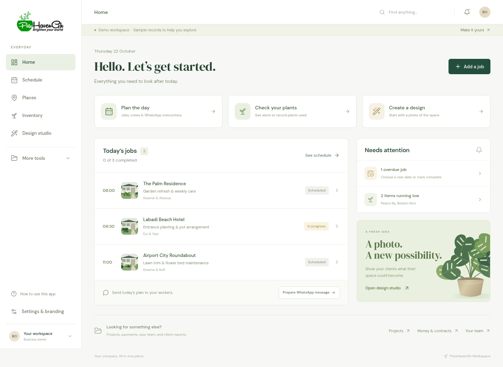

# PotsHavenGh

A simple landscaping and decorating workspace for the owner and manager. Workers receive instructions through WhatsApp. The everyday menu is **Home, Schedule, Places, Inventory, and Design studio**; projects, team, finance and reports are under **More tools**.



## Vercel + Supabase

The Vercel site needs the included serverless backend and a database. Follow [SUPABASE_SETUP.md](SUPABASE_SETUP.md) to create/connect a Supabase project, add its private `DATABASE_URL` plus owner/manager passwords in Vercel, then redeploy. `vercel.json` routes API and authenticated media requests to `api/index.js`; `dist` serves the screens. Hosted records and photos persist in a private PostgreSQL schema, with no temporary SQLite fallback.

The repository has no database credentials. Supabase/Vercel account settings must be connected securely by the account owner. Image generation additionally requires a private `POTSHAVEN_OPENAI_KEY`.

## Local development

Requires **Node.js 24** and npm:

```sh
npm ci
npm run dev
```

The screens and API run together on **one port, 5173**, using `server/dev.js`. `PORT` changes both together. Run the npm command rather than launching Vite alone. Paths are resolved from the project, so launching from another working directory works.

Local development uses SQLite at `.data/potshaven.db` with clearly labelled fictional demonstration records. Photos are stored in `.data/uploads` and generated images in `.data/designs`; no photos or secrets are committed to Git. Supabase is not needed for local development. To start a separate empty local company workspace while preserving the demo, use a new directory:

```sh
DATA_DIR=.data-company DATA_SEED=false npm run dev
```

Copy `.env.example` to a private `.env` for local configuration. Set both `APP_OWNER_PASSWORD` and `APP_MANAGER_PASSWORD` before sharing real company records. Without them the local app is explicitly a demo with owner access. Production hosting must use HTTPS.

## Checks

```sh
npm run build            # TypeScript + production bundle
npm test                 # SQLite, PostgreSQL, API, media and cloud-handler tests
npm run test:production  # Production assets, private sign-in, empty workspace
npm run test:browser     # Operations, inventory, recovery and image preparation
```

Browser checks use `/usr/bin/chromium` when available; otherwise run `npx playwright install chromium` or set `CHROMIUM_PATH`. Tests use temporary databases and servers, leaving company records alone. PostgreSQL tests run SQL against PGlite; they do not require or provision a live Supabase account.

## Included workflows

- Places, clients, measurements, site photos, inspections, and maintenance history.
- Daily jobs, assigned crews and vehicles, ordered routes, checklists, completion photos, and recurring maintenance. WhatsApp sharing prepares a message for the manager to send; replies do not sync automatically.
- Plant photos, stock counts, usage/restocking history, low-stock alerts and atomic deductions linked to job costs.
- Projects, deadlines, task progress, budgets, direct costs, and stock consumption costs.
- Purchase approvals, equipment servicing, plant care guides, crew skills/workload and transport/fuel costs.
- Maintenance contracts, payments, expenses, client issues, branded service reports and a portfolio.
- Photo-based image generation and refinement, official PotsHavenGh branding, and watermarked downloads. Measurements guide concepts; images are not construction drawings.

Reminders are in-app. Email, automatic WhatsApp sending and route optimisation are not configured.

## Loading and recovery

Pages load on demand. Ordinary changes update the affected record without fetching the entire company again. Uploaded photos are resized before sending, stored separately, and privately cached. Temporary read failures retry automatically; a later interruption keeps already loaded records visible and prevents saves until reconnected. Writes are never automatically retried, avoiding duplicate stock deductions.

Local production: `npm run build && npm start` serves the UI and API together on `PORT` (default3001). Keep backups of the SQLite database, `uploads` and `designs` directories together, using SQLite’s backup API while live. Supabase hosts these records and media in the same managed database. Currency settings change labels, not existing monetary values.

A [Dockerfile](Dockerfile) and [Render blueprint](render.yaml) remain available for an alternative SQLite service with a persistent disk; the Render plan is paid and has not been provisioned. No live hosting account is created by these files.

Details: [API](server/API.md) · [PostgreSQL adapter](server/POSTGRES.md) · [Supabase setup](SUPABASE_SETUP.md).
